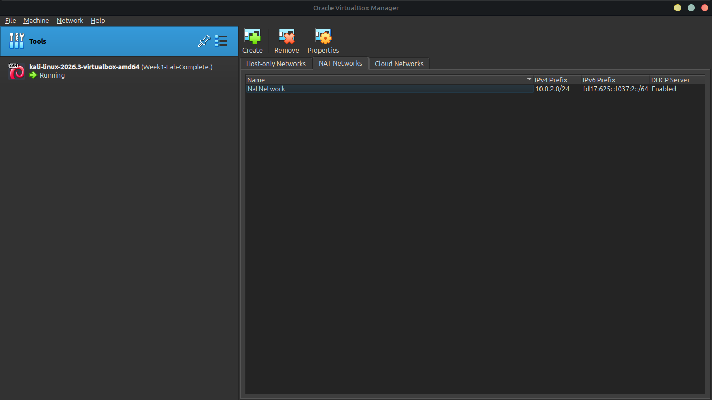
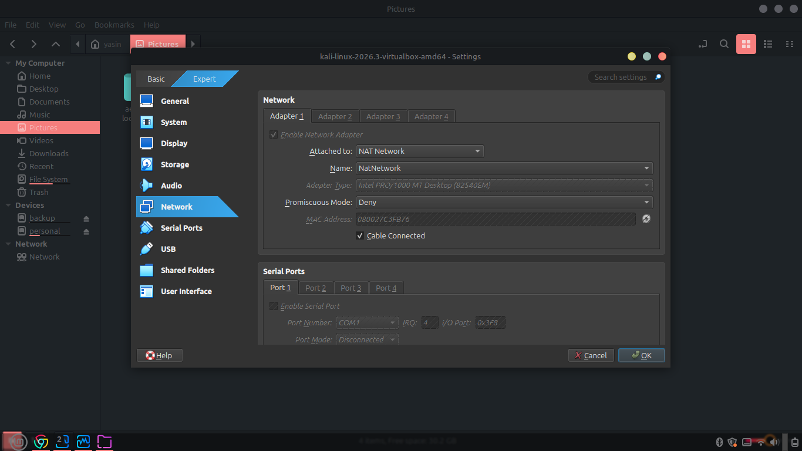
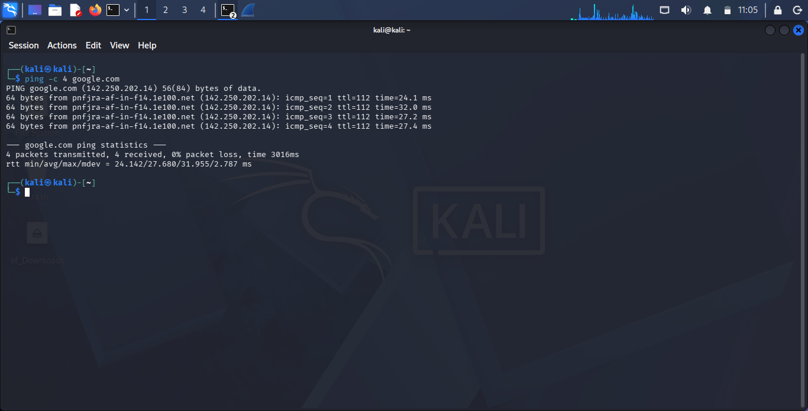
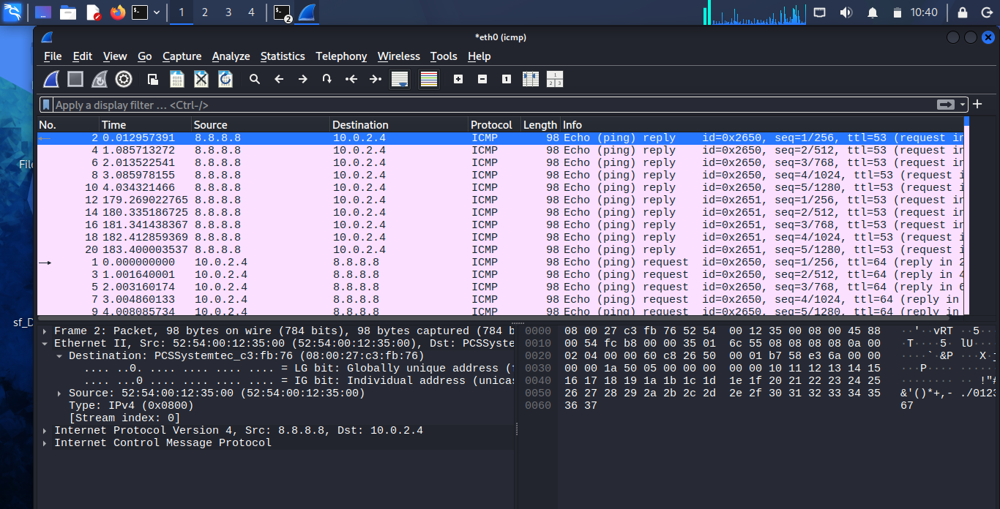
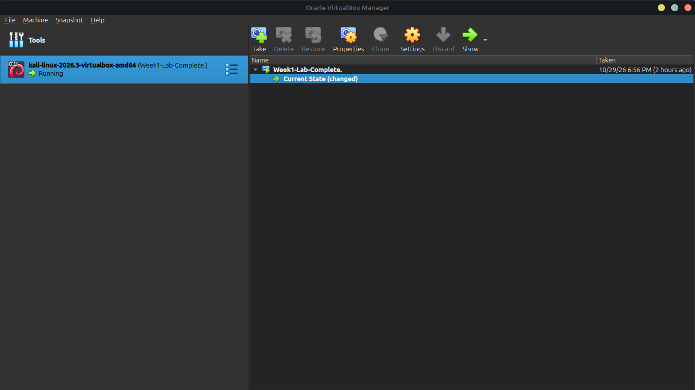

# NETWORKWALKS-YASIN-B084-WK1-PM1-CYBERSECURITY-LAB-SETUP
Configured an isolated penetration testing lab using VirtualBox, Kali Linux, custom NATNetwork (10.0.2.0/24), and Wireshark ICMP packet inspection.
# Cybersecurity Lab Environment Setup (Week 1 Project)

Building an isolated virtual lab for penetration testing, packet analysis, and ethical hacking practice.

## 🛠️ Lab Environment Details
* **Base Platform:** Oracle VirtualBox
* **Attacker Machine:** Kali Linux (2026.3)
* **Network Architecture:** Custom NATNetwork (`10.0.2.0/24`)
* **Network Adapter Type:** Intel PRO/1000 MT Desktop
* **Host Integration:** Shared folders enabled (`/media/sf_Downloads`), clipboard & drag/drop active

---

## 📋 Step-by-Step Implementation & Verification

### 1. VirtualBox Network Configuration
* Created a custom NATNetwork with IPv4 prefix `10.0.2.0/24` and enabled DHCP.
* Configured Kali Linux Adapter 1 to attach to the `NatNetwork`.

### 2. Network Connectivity & Troubleshooting
* Restored full internet access and DNS resolution within Kali Linux using NetworkManager (`nmcli`).
* Verified stable connection with 0% packet loss via ping tests.

### 3. Wireshark Packet Analysis
* Launched Wireshark on the active interface (`eth0`) to inspect live traffic, capture ICMP packets, and record source/destination IP addresses.

---
## 📸 Lab Screenshots

### 1. VirtualBox NAT Network Setup

### 2. Kali Linux VM Network Adapter

### 3. Kali Linux Ping Verification (0% Packet Loss)

### 4. Wireshark Packet Capture

### 5. VirtualBox Snapshot Confirmation (`Week1-Lab-Complete`)

